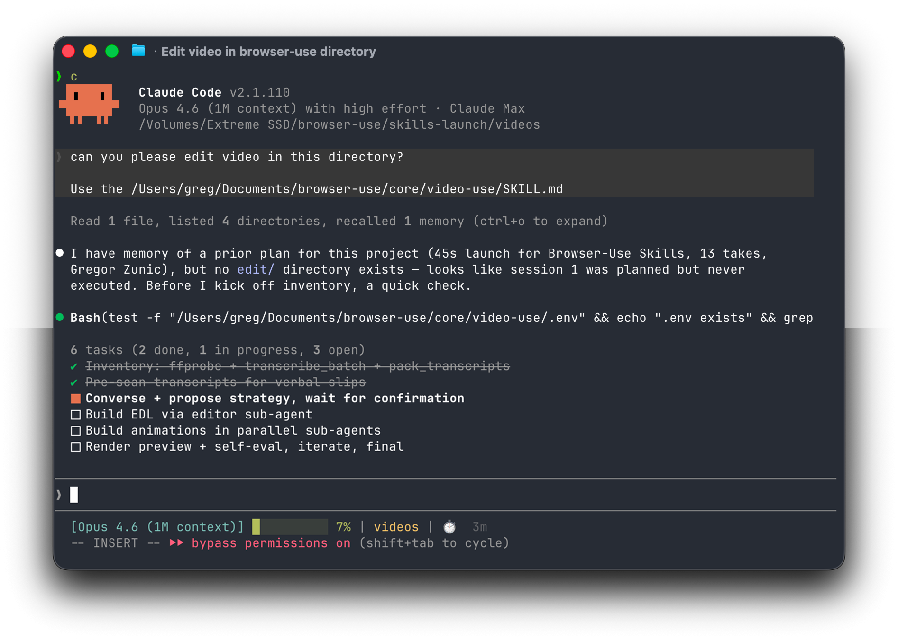
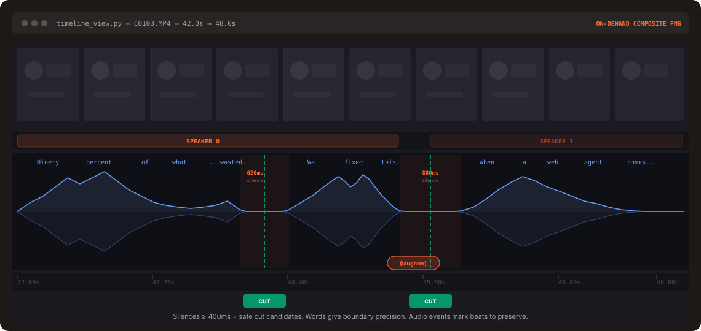

# VIDEO AI EDITOR V14

V14 adds Creative Director, Dynamic Editing, AI Voice planning, Text+Voice coordination and Payoff Director 2.0.

<p align="center">
  
</p>

# video-use

Introducing **video-use** — edit videos with Claude Code. 100% open source.

Drop raw footage in a folder, chat with Claude Code, get `final.mp4` back. Works for any content — talking heads, montages, tutorials, travel, interviews — without presets or menus.

Cloud-hosted video-use is coming. [Join the waitlist at video-use.com](https://video-use.com?utm_source=github).

## What it does

- **Cuts out filler words** (`umm`, `uh`, false starts) and dead space between takes
- **Auto color grades** every segment (warm cinematic, neutral punch, or any custom ffmpeg chain)
- **30ms audio fades** at every cut so you never hear a pop
- **Burns subtitles** in your style — 2-word UPPERCASE chunks by default, fully customizable
- **Generates animation overlays** via [HyperFrames](https://github.com/heygen-com/hyperframes), [Remotion](https://www.remotion.dev/), [Manim](https://www.manim.community/), or PIL — spawned in parallel sub-agents, one per animation
- **Self-evaluates the rendered output** at every cut boundary before showing you anything
- **Persists session memory** in `project.md` so next week's session picks up where you left off

## Setup prompt

Paste into Claude Code, Codex, Hermes, Openclaw, or any agent with shell access:

```text
Set up https://github.com/browser-use/video-use for me.

Read install.md first to install this repo, wire up ffmpeg, register the skill with whichever agent you're running under, and set up the ElevenLabs API key — ask me to paste it when you need it. Then read SKILL.md for daily usage, and always read helpers/ because that's where the editing scripts live. After install, don't transcribe anything on your own — just tell me it's ready and wait for me to drop footage into a folder.
```

The agent handles the clone, dependencies, skill registration, and prompts you once for your ElevenLabs API key (grab one at [elevenlabs.io/app/settings/api-keys](https://elevenlabs.io/app/settings/api-keys)).

Then point your agent at a folder of raw takes:

```bash
cd /path/to/your/videos
claude    # or codex, hermes, etc.
```

For always-on editing from your own VPS or Telegram, run the agent through [Browser Use Box](https://browser-use.com/bux). [Watch the 15-second demo](https://www.tiktok.com/@browser_use/video/7639824093721758989).

And in the session:

> edit these into a launch video

It inventories the sources, proposes a strategy, waits for your OK, then produces `edit/final.mp4` next to your sources. All outputs live in `<videos_dir>/edit/` — the skill directory stays clean.

## Manual install

If you'd rather do it by hand:

```bash
# 1. Clone and symlink into your agent's skills directory
git clone https://github.com/browser-use/video-use ~/Developer/video-use
ln -sfn ~/Developer/video-use ~/.claude/skills/video-use        # Claude Code
# ln -sfn ~/Developer/video-use ~/.codex/skills/video-use       # Codex

# 2. Install deps
cd ~/Developer/video-use
uv sync                         # or: pip install -e .
brew install ffmpeg             # required
brew install yt-dlp             # optional, for downloading online sources

# 3. Add your ElevenLabs API key
cp .env.example .env
$EDITOR .env                    # ELEVENLABS_API_KEY=...
```

## How it works

The LLM never watches the video. It **reads** it — through two layers that together give it everything it needs to cut with word-boundary precision.

<p align="center">
  
</p>

**Layer 1 — Audio transcript (always loaded).** One ElevenLabs Scribe call per source gives word-level timestamps, speaker diarization, and audio events (`(laughter)`, `(applause)`, `(sigh)`). All takes pack into a single ~12KB `takes_packed.md` — the LLM's primary reading view.

```
## C0103  (duration: 43.0s, 8 phrases)
  [002.52-005.36] S0 Ninety percent of what a web agent does is completely wasted.
  [006.08-006.74] S0 We fixed this.
```

**Layer 2 — Visual composite (on demand).** `timeline_view` produces a filmstrip + waveform + word labels PNG for any time range. Called only at decision points — ambiguous pauses, retake comparisons, cut-point sanity checks.

> Naive approach: 30,000 frames × 1,500 tokens = **45M tokens of noise**.
> Video Use: **12KB text + a handful of PNGs**.

Same idea as browser-use giving an LLM a structured DOM instead of a screenshot — but for video.

## Pipeline

```
Transcribe ──> Pack ──> LLM Reasons ──> EDL ──> Render ──> Self-Eval
                                                              │
                                                              └─ issue? fix + re-render (max 3)
```

The self-eval loop runs `timeline_view` on the _rendered output_ at every cut boundary — catches visual jumps, audio pops, hidden subtitles. You see the preview only after it passes.

## Design principles

1. **Text + on-demand visuals.** No frame-dumping. The transcript is the surface.
2. **Audio is primary, visuals follow.** Cuts come from speech boundaries and silence gaps.
3. **Ask → confirm → execute → self-eval → persist.** Never touch the cut without strategy approval.
4. **Zero assumptions about content type.** Look, ask, then edit.
5. **12 hard rules, artistic freedom elsewhere.** Production-correctness is non-negotiable. Taste isn't.

See [`SKILL.md`](./SKILL.md) for the full production rules and editing craft.

## V2: short-form / low-dialogue video analysis

V2 adds a local-first path for TikTok/Reels/Shorts footage where transcript-first editing is not enough.

```bash
python helpers/analyze_short.py input.mp4 -o edit/analysis.json
python helpers/make_short_edl.py edit/analysis.json -o edit/edl.short.json --target 20 --aspect 9:16
python helpers/render.py edit/edl.short.json -o edit/final.mp4
```

`analyze_short.py` detects scene changes, audio beats, tempo and source metadata without a cloud API. The generated scene/beat JSON is intended to be combined with `timeline_view.py` for visual reasoning. `make_short_edl.py` creates a conservative starter montage, and `render.py` now accepts `output.aspect` (`9:16`, `16:9`, `1:1`, or `source`) for deterministic center-cropping.

This intentionally does **not** blindly erase detected text/logos: static text can be legitimate content. An agent should visually inspect candidate regions first, then apply a reviewed crop/mask/clean-up step.

### Dynamic short-form captions
Use `--build-subtitles --caption-style auto_dynamic` for Text Engine V3. It switches visual treatment cue-by-cue between `hook`, `emphasis`, `number`, `cta`, `emotion`, and normal `viral_pop`, using transcript timing plus optional AI-authored `caption_events`. Fixed styles remain available: `viral_pop`, `punch`, `clean`, `cinematic`, and legacy `classic`. See `TEXT_ENGINE_V3.md`.

## V5 AI Director
V5 can automatically inspect each detected scene and populate V4 `visual_text_events` before rendering. See `AI_DIRECTOR_V5.md` and `helpers/ai_director.py`.

## V6 Creative Director
V6 adds edit-level creative direction: highlight ranking, hook/payoff roles, beat-aware trims, speed changes, subtle zoom motion, transition/SFX intent, and grade/music strategy. `render.py` now understands per-range `speed` and `motion`, including caption retiming. See `CREATIVE_DIRECTOR_V6.md`.

## V7 — one-command Auto Viral Editor

Run the complete local short-form pipeline plus QC and one conservative auto-repair pass:

```bash
python helpers/auto_viral_editor.py input.mp4 -o final.mp4 --target 20 --aspect 9:16
```

See `AUTO_VIRAL_EDITOR_V7.md` for details. “Viral” here describes the editing style/goal; no local heuristic can guarantee distribution or engagement.

## V10 Multimodal Story Director
V10 adds contact-sheet vision packets, optional provider-neutral VLM scene semantics, cold-open hook selection, payoff selection, narrative reordering, and preservation of V9 smart reframing. See `V10_MULTIMODAL_STORY_DIRECTOR.md`.


## V12 Viral Engine
Use EDIT_VIDEO.bat for SMART default. See V12_VIRAL_ENGINE.md and HUONG_DAN_V12.txt.

## V13
See V13_STORY_INTELLIGENCE.md.
